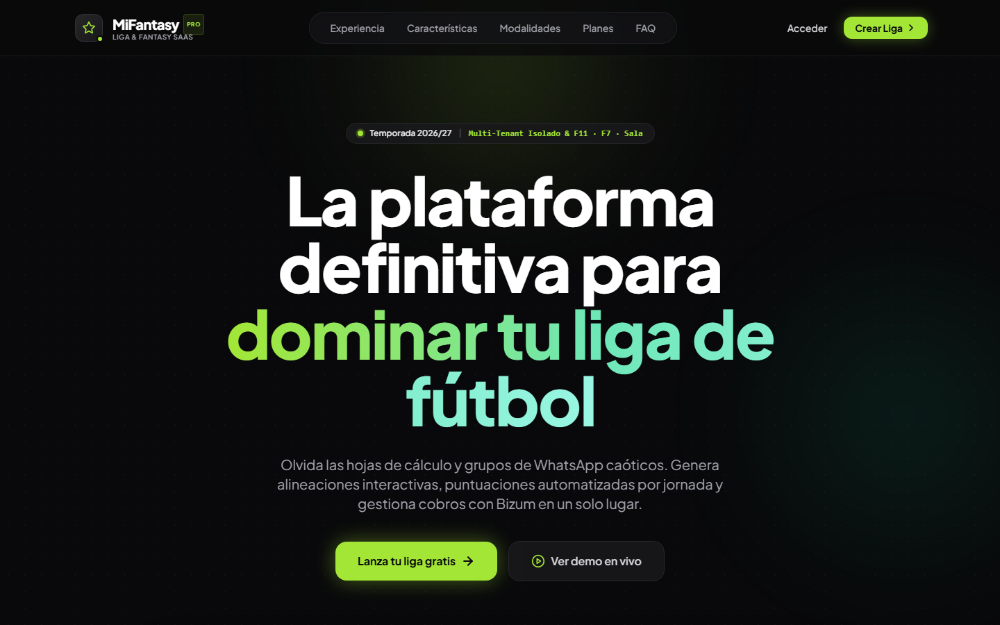
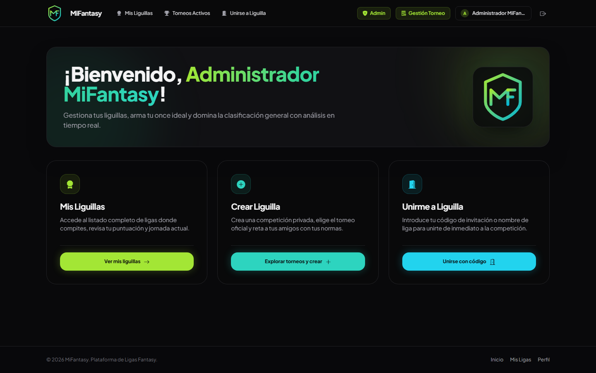
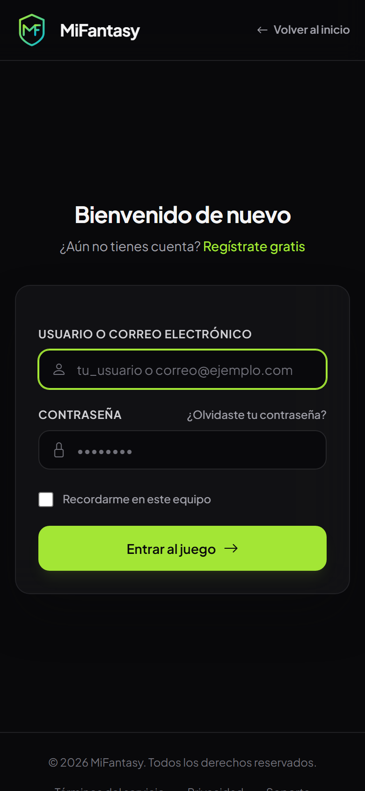
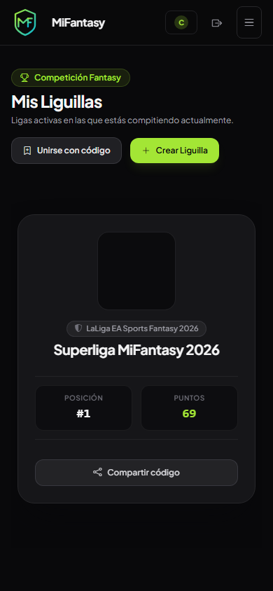
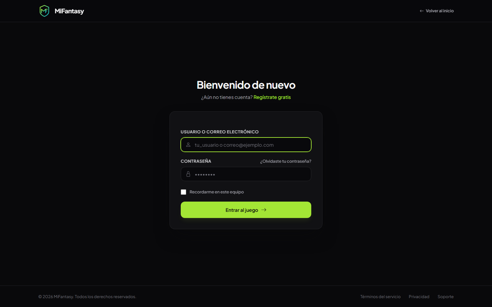
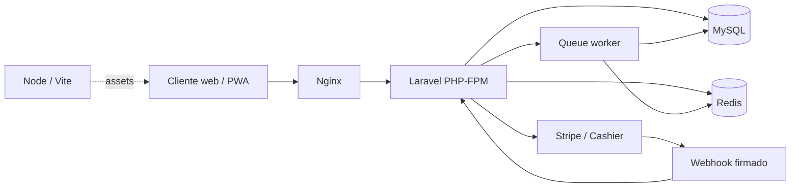
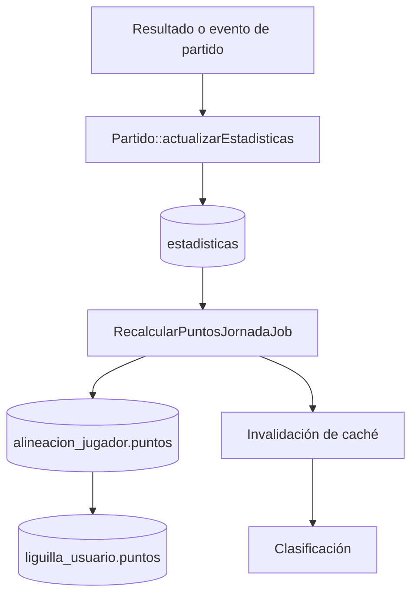
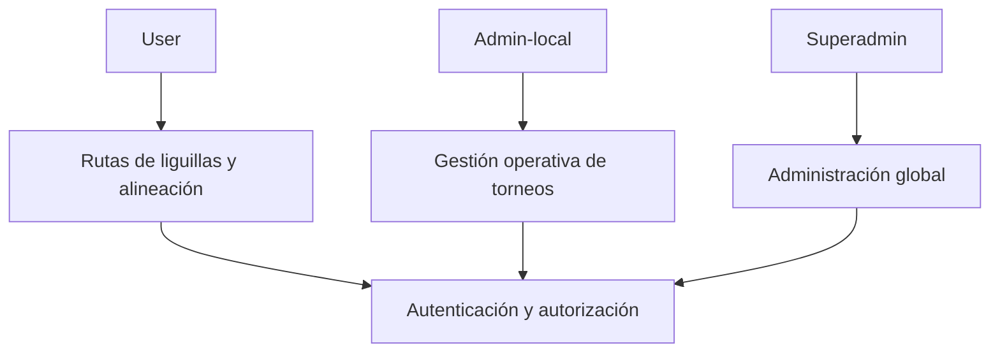
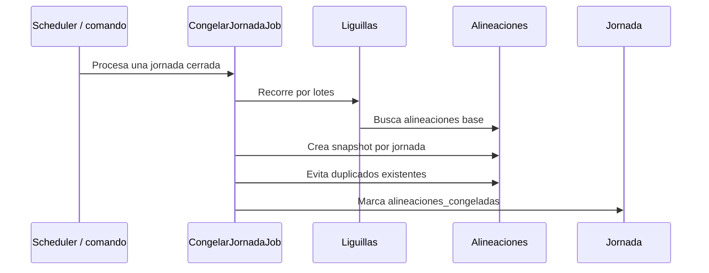
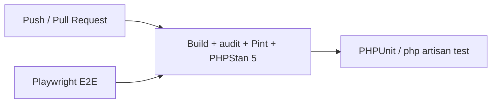

# MiFantasy
[](LICENSE)


Plataforma fantasy para torneos de fútbol no profesional

> **Copyright © 2026 Urki Aristu Viela. Todos los derechos reservados.**
>
> Este repositorio se publica exclusivamente para demostración técnica, portfolio y evaluación académica. Consulta [`LICENSE`](LICENSE) y [`NOTICE.md`](NOTICE.md) antes de reutilizar cualquier material.

## TL;DR · English

MiFantasy is a fantasy football web application designed for non-professional competitions: local, amateur and charity tournaments. Users create or join private leagues, build squads and submit line-ups. Local administrators manage competition data, while super administrators oversee the platform.

The project is a Master's Thesis in Computer Engineering at UPNA by Urki Aristu Viela. The repository is proprietary and published only for technical demonstration, portfolio review and academic evaluation. See [`LICENSE`](LICENSE) for usage restrictions.

## Índice

- [Qué es MiFantasy](#qué-es-mifantasy)
- [Roles funcionales](#roles-funcionales)
- [Galería](#galería)
- [Cómo funciona el juego](#cómo-funciona-el-juego)
- [Arquitectura](#arquitectura)
- [Stack tecnológico](#stack-tecnológico)
- [Calidad e ingeniería](#calidad-e-ingeniería)
- [Estado del proyecto](#estado-del-proyecto)
- [Estructura relevante](#estructura-relevante)
- [Exploración técnica externa](#exploración-técnica-externa)
- [Autoría y contexto académico](#autoría-y-contexto-académico)
- [Licencia y permisos](#licencia-y-permisos)

## Qué es MiFantasy

MiFantasy adapta el formato fantasy a competiciones que normalmente no disponen de una plataforma especializada: torneos locales, fútbol amateur y eventos solidarios. La aplicación transforma los partidos y sus eventos en una competición paralela de gestión de plantilla, alineaciones y puntos.

El alcance funcional actual se organiza alrededor de tres perfiles:

- **User:** participa en liguillas y gestiona su equipo fantasy.
- **Admin-local:** administra la información operativa de los torneos que gestiona.
- **Superadmin:** administra globalmente los usuarios, torneos y datos principales de la plataforma.

## Roles funcionales

| Rol | Capacidades documentadas |
|---|---|
| **User** | Crear o unirse a liguillas, consultar torneos, gestionar plantilla, elegir formación y alineación, consultar clasificación, jornadas, resultados, participantes y puntos en directo. |
| **Admin-local** | Gestionar equipos, jornadas, partidos y eventos de los torneos bajo su responsabilidad. |
| **Superadmin** | Gestionar globalmente usuarios, torneos, equipos, jugadores, liguillas, jornadas, partidos y eventos. |

Estos son los tres roles funcionales que se presentan en este README. La documentación no presenta ninguna capa comercial o de infraestructura como un cuarto rol.

## Galería

Las imágenes son recursos versionados del repositorio y se muestran como material de demostración comparativo entre vistas de escritorio y móvil.

| Pantalla | Escritorio (1440px) | Móvil (390px) |
|:---|:---:|:---:|
| **Landing pública** |  | — |
| **Autenticación** |  | — |
| **Home del usuario** |  |  |
| **Liguillas** |  |  |
| **Panel Admin-local** |  | — |
| **Panel Superadmin** |  | — |

Las capturas se generaron con Playwright sobre datos del seeder de desarrollo. No contienen credenciales visibles ni datos personales introducidos por usuarios reales.


## Cómo funciona el juego

### Flujo de una jornada

1. El administrador registra el resultado y los eventos del partido.
2. `Partido::actualizarEstadisticas()` crea o reemplaza las estadísticas de los jugadores.
3. `RecalcularPuntosJornadaJob` actualiza los puntos de las alineaciones congeladas y los acumulados de la liguilla.
4. Se invalidan las claves de caché de clasificación afectadas.
5. La interfaz consulta clasificación y puntos en directo mediante las rutas de la liguilla.

### Puntuación actual

| Evento o resultado | Puntos |
|---|---:|
| Victoria del equipo | +3 |
| Empate del equipo | +1 |
| Derrota del equipo | 0 |
| Gol | +5 |
| Asistencia | +3 |
| Parada | +2 |
| Falta | −1 |
| Tarjeta amarilla | −3 |
| Tarjeta roja | −5 |

Los valores proceden de `app/Models/Partido.php` y describen la implementación actual.

### Formaciones

| Modalidad | Formaciones disponibles |
|---|---|
| Fútbol 11 | 4-4-2, 4-3-3, 3-5-2, 5-3-2, 3-4-3 |
| Fútbol 7 | 3-2-1, 2-3-1, 2-2-2, 3-1-2 |
| Fútbol sala | 1-2-1, 2-2, 1-1-2, 2-1-1 |

### Congelado de alineaciones

El comando de congelado selecciona jornadas cerradas y delega el trabajo en `CongelarJornadaJob`. El job procesa las liguillas por lotes, crea una fotografía de cada alineación base para la jornada y evita duplicarla si ya existe. Después marca la jornada como congelada.

## Arquitectura

### Ejecución de la aplicación



La topología corresponde a los servicios declarados en `docker-compose.yml`. No se incluyen credenciales, tokens ni valores operativos.

### Flujo de puntuación



### Roles y alcance



### Congelado de jornadas



### Calidad y pruebas



## Stack tecnológico

| Tecnología | Uso | Fuente |
|---|---|---|
| PHP 8.2+ | Backend | `composer.json`, CI |
| Laravel 12 | Framework web, rutas, jobs y ORM | `composer.json` |
| Blade | Vistas | `resources/views/` |
| Alpine.js / JavaScript | Interactividad | `resources/`, `package.json` |
| Vite | Construcción de assets | `package.json`, `vite.config.js` |
| MySQL 8.0 | Persistencia en Docker | `docker-compose.yml` |
| Redis | Caché y colas | `docker-compose.yml` |
| Docker Compose | Orquestación | `docker-compose.yml` |
| Laravel Cashier | Suscripciones y Stripe | `composer.json` |
| Spatie Permission | Permisos administrativos | `composer.json` |
| Playwright 1.63 | Pruebas de navegador | `package.json`, `playwright.config.js` |
| PHPUnit 11 | Pruebas PHP | `composer.json` |
| Larastan/PHPStan nivel 5 | Análisis estático | `phpstan.neon`, CI |
| Laravel Pint | Estilo PHP | CI |

## Calidad e ingeniería

El workflow de GitHub Actions ejecuta actualmente:

- `npm run build`;
- `composer audit --locked`;
- `./vendor/bin/pint --test`;
- `./vendor/bin/phpstan analyse --memory-limit=2G`;
- `php artisan test` con SQLite en memoria para CI.

La suite Playwright está configurada en `playwright.config.js`, utiliza `tests/browser`, ejecución secuencial y un servidor local de pruebas. El workflow CI/CD ejecuta también esta suite E2E después de levantar la aplicación.

A nivel de diseño, el código utiliza autenticación Laravel, validación de formularios, CSRF en las rutas web, autorización mediante middleware/policies y verificación de firma para el webhook de Stripe. Esta descripción no sustituye una auditoría independiente.

## Estado del proyecto

| Área | Estado | Base verificable |
|---|---|---|
| Registro, login y verificación de email | ✅ Implementado | Rutas y controladores de autenticación |
| Liguillas, plantillas y alineaciones | ✅ Implementado | Controladores, acciones, modelos y vistas |
| Puntuación por resultados y eventos | ✅ Implementado | `Partido::actualizarEstadisticas()` |
| Congelado y recálculo de jornadas | ✅ Implementado | Comando, servicio y jobs |
| Panel Superadmin | ✅ Implementado | Rutas globales protegidas por `verificar.admin`; controladores `admin` |
| Panel Admin-local | ✅ Implementado | Grupo `/admin-local` protegido por `verificar.admin.local`; controladores `AdminLocal*` y Policies de recurso |
| PWA | ✅ Implementado | `public/manifest.json`, `public/sw.js` |
| Tests PHP | ✅ Implementado | `tests/`, CI |
| Tests Playwright | ✅ Implementado | `tests/browser/`, ejecución validada |
| Playwright en CI/CD | ✅ Implementado | Workflow de GitHub Actions |
| Suscripciones y checkout | 🟡 Parcial | Rutas, Cashier y controladores presentes |
| Mercado, notificaciones y despliegue comercial | 🔜 Roadmap | No se documentan como terminados |

## Estructura relevante

```text
app/
├── Actions/          Acciones de dominio
├── Console/          Comandos Artisan
├── Http/Controllers/ Controladores de usuario y administración
├── Jobs/             Congelado y recálculo de puntos
├── Models/           Torneos, equipos, jugadores y liguillas
├── Policies/         Autorización de recursos
└── Services/         Servicios de dominio

database/
├── migrations/       Esquema de persistencia
└── seeders/          Datos de demostración y pruebas

resources/views/      Vistas Blade
public/               Manifest, service worker y assets
tests/                Tests PHP y navegador
.github/workflows/    Automatización de calidad y tests PHP
docs/img/             Capturas versionadas
```

## Exploración técnica externa

La documentación canónica y fuente de verdad de la arquitectura es este README junto con sus diagramas Mermaid versionados. 

Los siguientes servicios externos se enlazan exclusivamente como vistas complementarias de exploración técnica generadas de forma automática a partir del código fuente del repositorio:

[![DeepWiki](https://img.shields.io/badge/-Ask%20DeepWiki-blue.svg?style=flat&labelColor=181717&logo=)](https://deepwiki.com/UrkiAristu/MiFantasy)
[](https://gitdiagram.com/UrkiAristu/MiFantasy)

## Autoría y contexto académico

MiFantasy se desarrolla como Trabajo Fin de Máster del **Máster en Ingeniería Informática de la Universidad Pública de Navarra (UPNA)**.

- **Autor:** Urki Aristu Viela
- **Primera versión del repositorio:** 17 de junio de 2025, según el primer commit disponible en el historial local.
- **Propósito:** demostración técnica, portfolio y evaluación académica.

## Licencia y permisos

MiFantasy **no se distribuye bajo una licencia open source**. El uso permitido se limita a la consulta con fines de demostración técnica, portfolio y evaluación académica.

- [`LICENSE`](LICENSE): condiciones completas en español e inglés.
- [`NOTICE.md`](NOTICE.md): aviso breve de titularidad.

Queda prohibido copiar, modificar, redistribuir, sublicenciar, explotar comercialmente o utilizar el código y sus materiales para entrenar o alimentar modelos de inteligencia artificial sin autorización escrita del autor.

Un README y una licencia establecen derechos y condiciones, pero no impiden técnicamente que alguien copie un repositorio público. Para una protección más fuerte: repositorio privado, acceso solo a evaluadores o publicación de una versión demo recortada.

Para cualquier uso distinto de la consulta autorizada, contactar con el autor y solicitar permiso por escrito.
